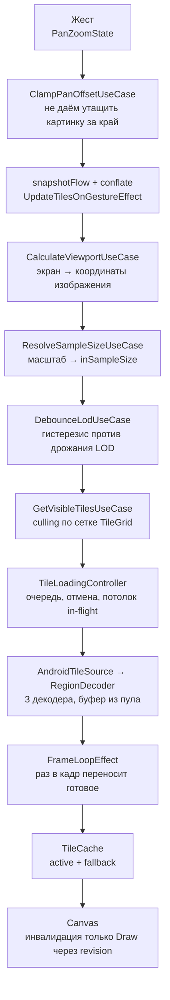

# Как это устроено

Разбор реализации PanZoomDemo. Что делает каждое оружие, почему оно сделано именно так
и какие места в нём неочевидны.

Общее описание проекта и инструкция по запуску лежат в [README](README.md).
Измеренный вклад каждой оптимизации лежит в [METRICS.md](METRICS.md).

## Содержание

- [Путь одного тайла](#путь-одного-тайла)
- [Оружие 1. Региональное декодирование и culling](#оружие-1-региональное-декодирование-и-culling)
- [Оружие 2. LOD и субсемплинг](#оружие-2-lod-и-субсемплинг)
- [Оружие 3. Пул битмапов и асинхронная загрузка](#оружие-3-пул-битмапов-и-асинхронная-загрузка)
- [Оружие 4. Поздняя трансформация](#оружие-4-поздняя-трансформация)

---

## Путь одного тайла

От касания пальца до пикселя на экране.



Ключевая мысль в том, что ни одна стрелка на этой схеме не проходит через Composition.
Жест читается внутри корутины, тайлы переносятся в кадровом цикле, а Canvas подписан
на счётчик `revision`, который читается внутри `DrawScope`.

---

## Оружие 1. Региональное декодирование и culling

`BitmapRegionDecoder` умеет декодировать произвольный прямоугольник файла, не разворачивая
файл целиком. На это накладывается сетка `TileGrid` с клеткой 512×512 выходных пикселей.

```kotlin
// domain/model/TileGrid.kt
fun visibleTiles(viewport: ImageRect, sampleSize: Int): List<TileRect>
```

Culling - это просто выбор между `visibleTiles(viewport)` и `allTiles()`. Вся разница
в одном `if` внутри `GetVisibleTilesUseCase`, а в цифрах это разница между 256 МБ и 2 ГБ.

Два неочевидных момента.

- `BitmapRegionDecoder` **не потокобезопасен**. Поэтому в `RegionDecoderLocalDataSource`
  живёт пул из трёх декодеров, который раздаётся через `Channel` как suspend-семафор.
  Ждущий декодер видно в логе как `wait=...ms`.
- `decodeRegion` - это блокирующий JNI-вызов. Отмена корутины его не прерывает. Поэтому
  в `close()` утилизируются только простаивающие декодеры, а занятые убирают себя сами,
  когда вернутся в уже закрытый канал. Иначе процесс падает посреди декода на чужом потоке.

Под тайлами всегда лежит `overview` - уменьшенная копия всего изображения со стороной
не больше 1024 px. Она закрывает белые дыры на холодном старте и в ещё не загруженных
участках viewport.

---

## Оружие 2. LOD и субсемплинг

Клетка сетки растёт вместе с уровнем детализации и равна `tileSize * sampleSize` пикселей
исходника. Поэтому на любом уровне тайл декодируется в одни и те же 512×512 выходных
пикселей, а число видимых тайлов почти не зависит от зума. Это классическая пирамида.

Пороги лежат в `domain/model/SampleSize.kt` и раздвинуты на ±10 % вокруг центра.

| `inSampleSize` | Полоса стабильности по scale | Выходной тайл |
|:--------------:|------------------------------|---------------|
| 1 | scale ≥ 0.45 | 512 × 512 |
| 2 | 0.22 - 0.55 | 256 × 256 |
| 4 | 0.11 - 0.28 | 128 × 128 |
| 8 | scale < 0.14 | 64 × 64 |

Полосы намеренно перекрываются. Это гистерезис, он не даёт уровню дрожать на границе.
Поверх него стоит второй фильтр - `DebounceLodUseCase` применяет новый уровень только после
трёх запросов подряд, то есть примерно через 50 мс на 60 Гц. Первый защищает от дрожания
у порога, второй от перещёлкиваний при быстром пинче.

При смене уровня текущий активный слой тайлов становится `fallback` и продолжает рисоваться
под новым, пока новый догружается. Дыр на экране не возникает.

---

## Оружие 3. Пул битмапов и асинхронная загрузка

Тайлы постоянно появляются и исчезают. Без переиспользования каждый из них - это новая
аллокация на несколько мегабайт и разбуженный GC прямо посреди жеста.

`BitmapPoolLocalDataSource` раздаёт буферы через `BitmapFactory.Options.inBitmap`. Корзины
разложены по ключу `(width, height)`, потому что краевые тайлы меньше клетки, и буфер
полного размера дал бы растянутую картинку. Вытеснение идёт по LRU, бюджет 96 МБ.

При открытии изображения пул прогревается буферами полного тайла на пятую часть бюджета,
чтобы первые декоды не платили за аллокацию. Класс размеров ровно один, потому что в пирамиде
любой уровень декодируется в те же 512×512 выходных пикселей. Попадания и промахи видно
в логе строкой `pool stats`.

Загрузкой командует `TileLoadingController`.

- Очередь с потолком запусков за тик и потолком одновременных задач.
- Тайл, ушедший из viewport, снимается с загрузки. Смена LOD отменяет всё поколение задач.
- Готовые тайлы копятся в `pending` и переезжают в кеш ровно раз в кадр, в `FrameLoopEffect`.

Возврат буферов в пул отложен на три кадра. Битмап мог попасть в display list прошлого
кадра, и `recycle()` сразу после удаления из кеша уронил бы отрисовку.

Кадровый цикл **спит**, пока работы нет. Иначе `withFrameMillis` держал бы приложение
в непрерывном рендере и грел устройство на ровном месте.

---

## Оружие 4. Поздняя трансформация

Это главный приём против второго врага, и он помещается в один модификатор.

```kotlin
// ✅ TiledCanvasWithLateTransformation.kt
// Состояние читается внутри лямбды graphicsLayer, то есть в фазе Draw.
// Composition при жесте не запускается вообще.
Canvas(
    modifier = Modifier
        .fillMaxSize()
        .then(gestureModifier)
        .graphicsLayer {
            translationX = panZoom.offset.x
            translationY = panZoom.offset.y
            scaleX = panZoom.scale
            scaleY = panZoom.scale
            transformOrigin = TransformOrigin(0f, 0f)
        },
) { ... }
```

```kotlin
// ❌ TiledCanvasWithEarlyTransformation.kt
// Те же значения читаются в теле composable, то есть в фазе Composition.
// Каждое движение пальца вызывает рекомпозицию, Skia пересобирает draw-list.
val scale = panZoom.scale
val offset = panZoom.offset

Canvas(modifier = Modifier.fillMaxSize().then(gestureModifier)) {
    drawTiles(activeTiles, scale, offset)
}
```

Разница в том, где происходит чтение состояния. В первом случае pan и zoom превращаются
в матрицу поверх готового RenderNode, и её применяет GPU. Во втором мы каждый кадр заново
собираем список команд отрисовки на CPU.

Наивный вьюер намеренно сделан по второму образцу, только ещё честнее - там
`graphicsLayer` в **параметрической** форме. Она выглядит почти так же, а читает состояние
в Composition. Это ровно та ловушка, ради которой стоит смотреть на модификатор внимательно.

Два неочевидных момента.

- **Порядок модификаторов важен.** `gestureModifier` стоит **перед** `graphicsLayer`.
  Слой разворачивает координаты обратно для всех вложенных модификаторов, и при scale
  меньше единицы hit-test перестаёт попадать в цель. Снаружи слоя `pointerInput` работает
  в координатах экрана и жесты принимает верно.
- **Как обновлять Canvas, не трогая Composition.** Набор тайлов меняется асинхронно, а
  `Map` наблюдаемым состоянием не является. Поэтому есть счётчик `revision` типа `IntState`,
  который читается **внутри** `DrawScope`. Само значение не нужно, нужен факт чтения.
  Такое чтение подписывает на изменения только фазу отрисовки.

---

Измеренный вклад каждого оружия лежит в [METRICS.md](METRICS.md).
