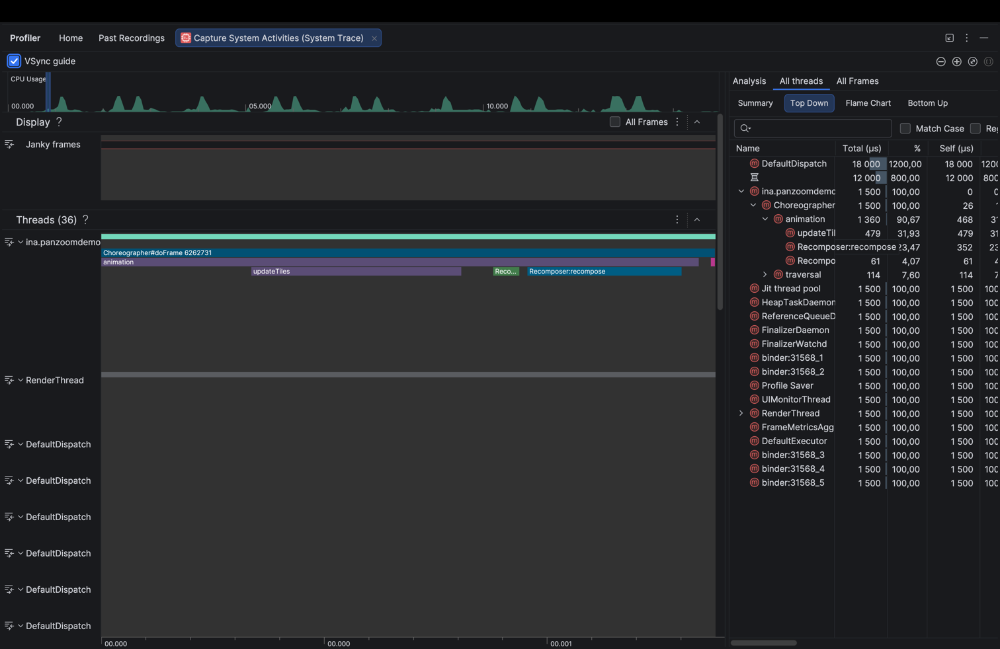
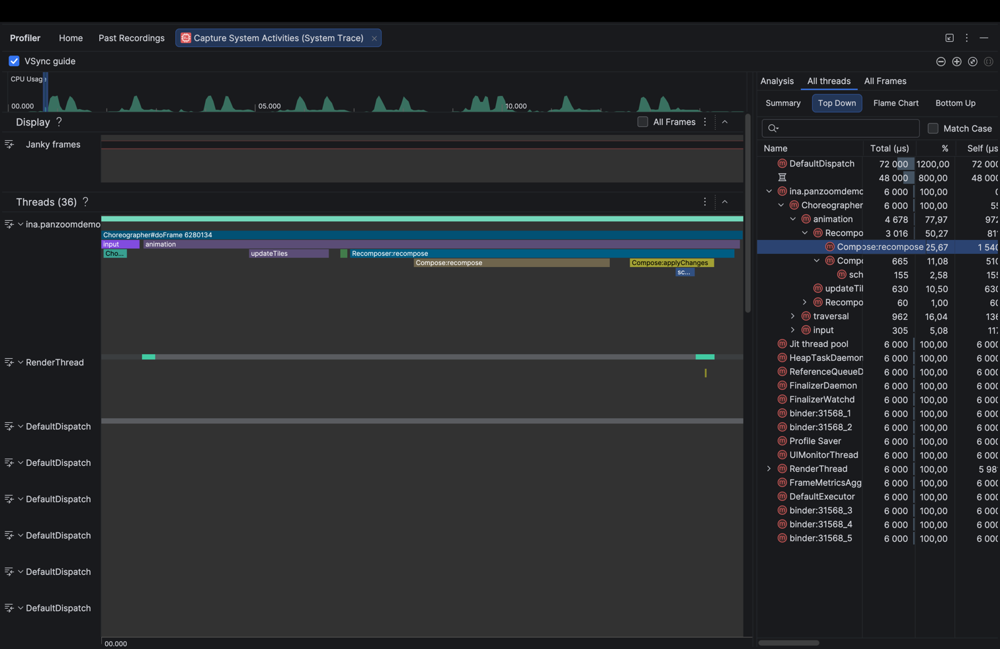

# Perfetto — замеры и выводы

**Устройство:** realme RMX3371 (Snapdragon 695, Android 14)
**Инструмент:** `actual_frame_timeline_slice` (SurfaceFlinger) + `Trace.beginSection` app-секции
**Конфиг:** `startperf.sh` (atrace_categories: app/view/am + atrace_apps + ftrace/print)

> **Замечание по `decodeTile.wait` в Perfetto:** значения раздуты из-за взаимодействия
> `Trace.beginSection`/`endSection` с корутинами — секция остаётся открытой на треде при
> suspend/resume корутины на другом потоке. Для wait-времени доверять logcat-значениям
> из `presentation/logs_measurements.md`.

---

## Прогон GL=ON — все оружия включены

**Трейс:** `GL-on_realme-RMX3371-Android-14_2026-09-30_1121.pb`
**Конфигурация:** Tiling ✅ Culling ✅ LOD ✅ GraphicsLayer ✅
**Жест:** горизонтальный пан туда-обратно в ровном темпе, 14.9 с
**Сырые данные:** `logdata/perfetto/GL-on_realme-RMX3371-Android-14_2026-09-30_1121/`

### Frames (SurfaceFlinger)

| Метрика                 | Значение                          |
|-------------------------|-----------------------------------|
| Всего фреймов           | 502                               |
| smooth                  | 279 (55.6%)                       |
| Buffer Stuffing         | 214 (42.6%) — on_time=1, не дроп  |
| **App Deadline Missed** | **9 (1.8%)**                      |
| late (on_time=0)        | 12 (2.4%)                         |
| avg frame dur           | 6.63 ms                           |
| max frame dur           | 31.95 ms                          |

Худшие поздние кадры, мс: 31.95, 30.13, 28.49, 27.98, 23.73.

### Custom slices (Trace.beginSection)

| Секция              | count |      avg |       max |     total |
|---------------------|------:|---------:|----------:|----------:|
| `updateTiles`       |   495 |  0.15 ms |   1.41 ms |   72.7 ms |
| `flushPendingTiles` |    56 |  0.02 ms |   0.13 ms |    1.3 ms |
| `decodeTile.decode` |    69 | 93.72 ms | 131.88 ms | 6466.6 ms |
| `decodeTile.wait`   |     0 |        — |         — |         — |

### Recompositions

| Имя                    |    count |
|------------------------|---------:|
| `Recomposer:animation` |      898 |
| `Recomposer:recompose` |      897 |
| `Compose:recompose`    |   **14** |
| **Итого**              | **1809** |

Rate: **121.1/sec**, avg 0.15 ms, max 7.92 ms, total **277.4 ms**

898 `Recomposer:animation` совпадают с числом кадров Choreographer — одна
animation-рекомпозиция на кадр всю сессию, её держит инерция после свайпа.

`Compose:recompose` всего 14 за 15 секунд. Скоупы, читающие pan и zoom, при включённом
тумблере не пересобираются: состояние читается в лямбде `graphicsLayer`, в фазе отрисовки.

### Main thread top

| Слайс                                         | count |     avg |     max |    total |
|-----------------------------------------------|------:|--------:|--------:|---------:|
| `Choreographer#doFrame`                       |   898 | 1.66 ms | 17.96 ms | 1493.4 ms |
| `checkForSemanticsChanges`                    |   106 | 0.73 ms |  4.44 ms |   77.6 ms |
| `getAllUncoveredSemanticsNodesToIntObjectMap` |   149 | 0.42 ms |  1.41 ms |   62.9 ms |
| `Choreographer#onVsync`                       |   898 | 0.04 ms |  0.49 ms |   37.4 ms |
| `deliverInputEvent`                           |    19 | 1.77 ms |  4.82 ms |   33.7 ms |

---

## Прогон GL=OFF — выключен только graphicsLayer

**Трейс:** `GL-off_realme-RMX3371-Android-14_2026-09-30_1122.pb`
**Конфигурация:** Tiling ✅ Culling ✅ LOD ✅ GraphicsLayer ❌
**Жест:** тот же, горизонтальный пан туда-обратно, 14.9 с
**Сырые данные:** `logdata/perfetto/GL-off_realme-RMX3371-Android-14_2026-09-30_1122/`

### Frames (SurfaceFlinger)

| Метрика                 | Значение                          |
|-------------------------|-----------------------------------|
| Всего фреймов           | 518                               |
| smooth                  | 340 (65.6%)                       |
| Buffer Stuffing         | 174 (33.6%) — on_time=1, не дроп  |
| **App Deadline Missed** | **4 (0.8%)**                      |
| late (on_time=0)        | 7 (1.4%)                          |
| avg frame dur           | 7.04 ms                           |
| max frame dur           | 27.08 ms                          |

Худшие поздние кадры, мс: 27.08, 25.95, 23.38, 22.79.

### Custom slices (Trace.beginSection)

| Секция              | count |      avg |       max |     total |
|---------------------|------:|---------:|----------:|----------:|
| `updateTiles`       |   513 |  0.14 ms |   1.78 ms |   71.2 ms |
| `flushPendingTiles` |    63 |  0.03 ms |   0.05 ms |    1.6 ms |
| `decodeTile.decode` |    75 | 94.28 ms | 148.55 ms | 7070.8 ms |
| `decodeTile.wait`   |     0 |        — |         — |         — |

### Recompositions

| Имя                    |    count |
|------------------------|---------:|
| `Recomposer:animation` |      897 |
| `Recomposer:recompose` |      897 |
| `Compose:recompose`    |  **526** |
| **Итого**              | **2320** |

Rate: **155.5/sec**, avg 0.28 ms, max 3.02 ms, total **656.2 ms**

Циклы рекомпозиции те же 897, а точечных пересборок внутри них в 37 раз больше.
Это и есть цена чтения pan и zoom в фазе Composition.

### Main thread top

| Слайс                                         | count |     avg |      max |    total |
|-----------------------------------------------|------:|--------:|---------:|---------:|
| `Choreographer#doFrame`                       |   897 | 1.99 ms | 11.35 ms | 1783.5 ms |
| `Choreographer#onVsync`                       |   897 | 0.04 ms |  0.22 ms |   34.2 ms |
| `deliverInputEvent`                           |    16 | 1.72 ms |  3.56 ms |   27.5 ms |
| `checkForSemanticsChanges`                    |    17 | 0.76 ms |  1.83 ms |   12.9 ms |

---

## GL=ON vs GL=OFF — сравнение

| Метрика                       | GL=ON      | GL=OFF     | Δ            |
|-------------------------------|:----------:|:----------:|:-------------|
| Всего фреймов                 | 502        | 518        | +3 %         |
| avg frame dur                 | 6.63 ms    | 7.04 ms    | +6 %         |
| App Deadline Missed           | 9          | 4          | −5 (разброс) |
| Buffer Stuffing               | 214        | 174        | −40          |
| `updateTiles` count           | 495        | 513        | +4 %         |
| `updateTiles` avg             | 0.15 ms    | 0.14 ms    | ≈            |
| `decodeTile.decode` avg       | 93.72 ms   | 94.28 ms   | ≈            |
| `Recomposer:recompose`        | 897        | 897        | =            |
| `Recomposer:animation`        | 898        | 897        | =            |
| **`Compose:recompose`**       | **14**     | **526**    | **×37.6 ❌**  |
| Recompose avg                 | 0.15 ms    | 0.28 ms    | ×1.9         |
| **Recompose total CPU**       | **277 мс** | **656 мс** | **×2.4 ❌**   |
| `Choreographer#doFrame` avg   | 1.66 ms    | 1.99 ms    | +20 %        |
| `Choreographer#doFrame` total | 1493 мс    | 1784 мс    | +19 %        |

### Выводы

- **`Compose:recompose` ×37.6.** Это и есть измеряемый эффект. С GL=OFF пересобираются
  конкретные скоупы, читающие pan и zoom напрямую; с GL=ON состояние читается в лямбде
  `graphicsLayer`, то есть в фазе отрисовки, и Composition к ним не обращается вовсе.
- **`Recomposer:recompose` одинаков, 897 против 897.** Сам цикл рекомпозиции запускается
  с той же частотой в обоих случаях, его будит анимация инерции. Тумблер на это не влияет
  и не должен: мерить надо не циклы, а точечные пересборки внутри них.
- **Recompose total CPU ×2.4**, 379 мс лишней работы за 15 секунд. Кадры не дропаются,
  но это тепло, батарея и съеденный запас до джанка.
- **`doFrame` +20 %.** Главный поток тратит на каждый кадр на 0.33 мс больше.
- **По пропущенным дедлайнам GL=OFF обогнал GL=ON**, 4 против 9, хотя должно было быть
  наоборот. Считать это эффектом тумблера нельзя: на девяти и четырёх событиях за сессию
  разброс между прогонами больше самой разницы. Это же показывает, почему на таком железе
  бесполезны JankStats и gfxinfo, которые кроме дедлайнов ничего и не считают.
- **`checkForSemanticsChanges` в шесть раз чаще при GL=ON** (106 против 17). Это не эффект
  тумблера, а побочный след другого маршрута пальца: семантика пересчитывается от касаний,
  а не от рекомпозиций.

---

## Технические заметки

### Buffer Stuffing

`Buffer Stuffing` (214 фреймов при GL=ON, 174 при GL=OFF) означает, что приложение отрендерило кадр, но
SurfaceFlinger обнаружил очередь буферов > 1. `on_time_finish=1` у всех — кадр зрителю
доставлен вовремя. Не является dropped frame. Типично при burst-рендеринге в начале сессии.

### decodeTile.wait vs logcat

`decodeTile.wait` нулевой: жест простой, очередь декодера не забивалась.
Но доверять этой секции в Perfetto нельзя в принципе.

Причина: `Trace.beginSection("decodeTile.wait")` стартует на IO-потоке, затем корутина
suspended (ждёт семафор или dispatcher). Thread освобождается, `endSection` приходит от
другой корутины на том же треде — секция закрывается в произвольный момент.
Для wait-времени брать logcat, а не Perfetto.

### Recompose nomenclature

- `Recomposer:recompose` — фактический recompose-цикл Compose Runtime
- `Recomposer:animation` — кадр анимации (AnimationState/Animatable/animate*)
- `Compose:recompose` — точечный recompose малого scope (InvalidationResult)

# Perfetto UI/Profiller

Через web-версию вьювера Perfetto не удалось качественно оценить треки в разных сценариях и
подтвердить корректность скриптов-парсеров.

Для подтверждения использовался Profiler - при открытии трейсов GL=ON и GL=OFF через
профайлер мы видим явное подтверждение сказанных ранее в презентации утверждений
и корректности парсинг-скриптов:

- в панеле `Analytics->All Frames->All Frames` видно, что данные идентичны данным, полученным через
  парсер и находящихся в `frames.csv`
- В расшифровке главного треда `ina.panzoomdemo` явно видна работа поздней трансформации:
    - Для каждого кадра в кейсе с включенными всеми оптимизациями отсутствует слой
      рекомпозиции Recomposer:recompose->Compose:recompose, который явно присутствует
      в кейсе выключенного тумблера GL.

Кадры выбраны по одному признаку: в обоих присутствует `updateTiles`, то есть тайлы
реально пересчитывались. Номер в названии кадра это vsync-токен, а не порядковый номер.

**GL=ON**, кадр `Choreographer#doFrame 6262731`. Под `Recomposer:recompose` пусто.

**GL=OFF**, кадр `Choreographer#doFrame 6280134`. Под `Recomposer:recompose` развернулись
`Compose:recompose` и `Compose:applyChanges`.

Увидеть оптимизацию не через цифры на моем устройстве, к сожалению, нельзя. В большей степени как
проблема, так и решение относится к слабеньким старым устройствам.